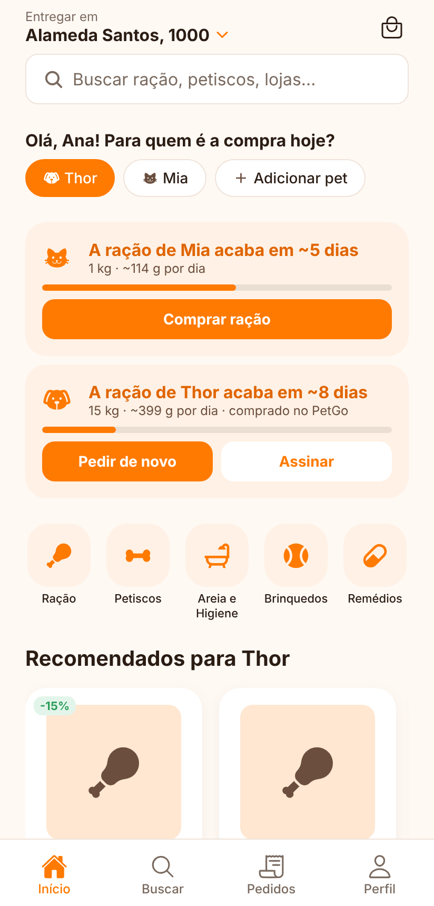
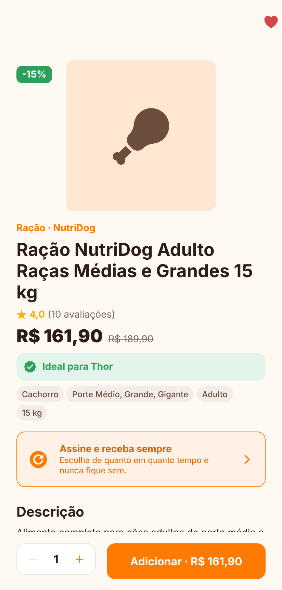
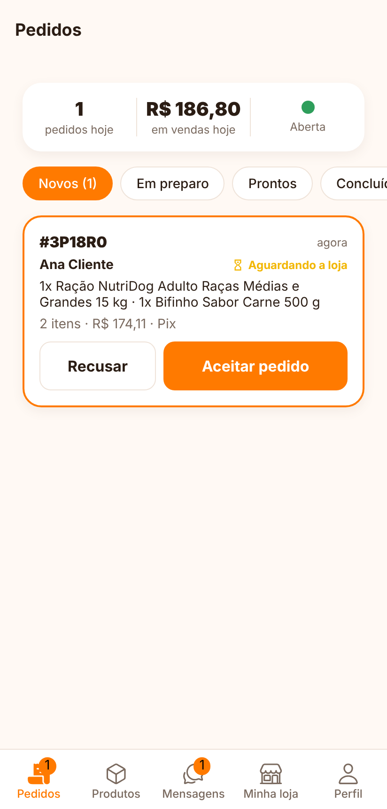
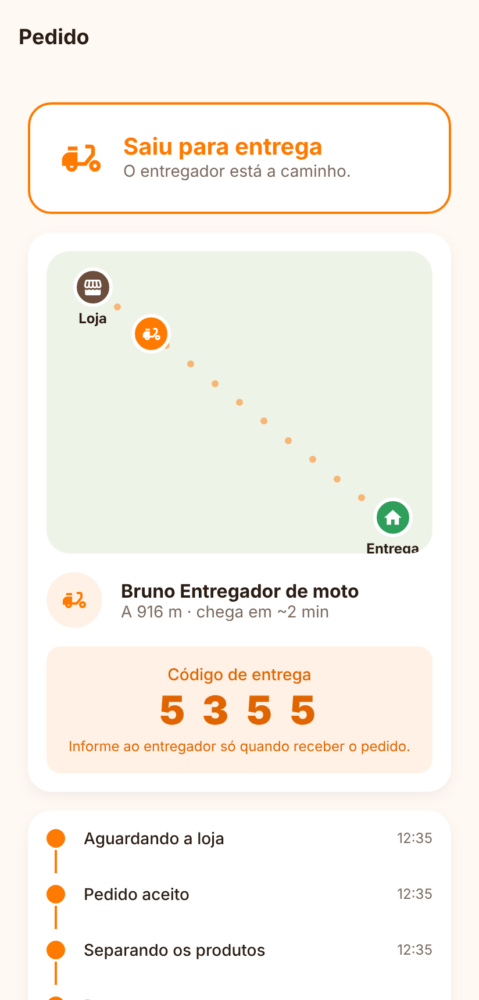

# 🐾 PetGo

Aplicativo de delivery de ração e produtos para animais domésticos, no estilo iFood.
Projeto da disciplina de Engenharia Móvel.

Um único app com três perfis:

| Perfil | O que faz |
|---|---|
| **Cliente (tutor)** | Cadastra pets, encontra pet shops, compra, acompanha a entrega, assina recompra automática |
| **Loja** | Gerencia produtos, aceita pedidos, conversa com clientes, cria cupons |
| **Entregador** | Aceita entregas, segue a rota e compartilha a localização em tempo real |

## Telas

<p>
  
  
  
  
</p>

Todas as telas (54), separadas por perfil, estão em **[docs/telas](docs/telas/README.md)**.

## Tecnologias

- [Expo](https://expo.dev) SDK 58 + React Native + TypeScript
- Expo Router (navegação por arquivos em `src/app/`)
- Zustand (estado global, sacola persistida)
- AsyncStorage (dados fictícios locais por enquanto)
- react-native-maps (mapas), expo-location (GPS do entregador), expo-image-picker (fotos) e expo-notifications (lembretes)
- Firebase (Auth, Firestore, Storage, Cloud Messaging), a ser conectado

## Como rodar

Pré-requisitos: Node.js 20+ e o app **Expo Go** no celular.

```bash
npm install
npx expo start
```

Leia o QR code com o Expo Go (Android) ou com a câmera (iOS). Para abrir no navegador: `npx expo start --web`.

### Contas de demonstração

Senha de todas: `123456`. Na tela de login há atalhos para preenchê-las.

| Perfil | E-mail |
|---|---|
| Cliente | cliente@petgo.com |
| Loja | loja@petgo.com |
| Entregador | entregador@petgo.com |

### Verificações antes de subir código

```bash
npx tsc --noEmit
npx eslint .
```

## Estrutura

```
docs/telas/              # Capturas de todas as telas, por perfil
src/
├── app/                 # Telas (cada arquivo é uma rota do Expo Router)
│   ├── (auth)/          # Boas-vindas, login, cadastro
│   ├── cliente/         # (tabs): início, buscar, pedidos, perfil + loja, produto, sacola,
│   │                    #   checkout, pedido, pets, endereços, chat, assinaturas, favoritos...
│   ├── loja/            # (tabs): pedidos, produtos, mensagens, minha loja, perfil
│   │                    #   + detalhe do pedido, produto, chat, cupons, avaliações
│   └── entregador/      # (tabs): entregas, ganhos, perfil + tela da entrega
├── components/          # Componentes reutilizáveis (ui/ = botões, campos, chips, estrelas...)
├── data/                # Dados fictícios: seed.ts, catalog.ts (lojas/produtos), demo.ts
├── hooks/               # useAsync, pedidos em tempo real, rastreio, lembretes de ração...
├── services/            # Acesso a dados
│   ├── types.ts         # Contratos de todos os serviços
│   ├── mock/            # Implementação local com AsyncStorage (atual)
│   └── index.ts         # Escolhe a implementação (mock → firebase)
├── store/               # Estado global (Zustand): login, sacola, favoritos
├── theme/               # Cores, espaçamentos e fontes do PetGo
├── types/models.ts      # Modelos: User, Pet, Store, Product, Order, Coupon, Chat...
└── utils/               # Formatação, filtros, distância, consumo de ração, notificações
```

### Por que a camada `services/`?

As telas nunca acessam o banco diretamente: chamam os serviços (`authService`, `catalogService`,
`orderService`, `deliveryService`, `chatService`...). Hoje eles leem e gravam dados fictícios no aparelho.
Para conectar o Firebase basta criar `services/firebase/` com as mesmas interfaces e trocar
uma linha em `services/index.ts`, sem mexer nas telas.

Espécies também são dados (`data/seed.ts`), não código: para incluir pássaros, peixes etc.
basta cadastrar uma nova espécie.

## Dados fictícios

- 5 pet shops em São Paulo (um deles fechado, para testar esse estado) e 80 produtos em 5 categorias.
- Marcas fictícias (NutriDog, FelinoPlus, VitaCão...).
- A cliente demo já tem 2 pets (Thor, cachorro; Mia, gata), 1 endereço e 1 pedido entregue há 30 dias
  (a ração do Thor), que alimenta o lembrete de ração e pode ser avaliado.
- Cupons de exemplo: `PETGO10` (10% acima de R$ 50), `FRETEGRATIS` (acima de R$ 80) e
  `AMIGO15` (R$ 15 off no Pet Shop Amigo Fiel, acima de R$ 100).
- Tudo fica salvo no aparelho. Para voltar ao estado inicial, limpe os dados do app (ou, na web, o armazenamento do site).

### Testando cliente e loja juntos

Como os dados ficam no próprio aparelho, dá para simular os dois lados:
faça um pedido com `cliente@petgo.com`, saia, entre com `loja@petgo.com`
(dona do *Pet Shop Amigo Fiel*) e aceite/prepare o pedido. Ao voltar para a
conta do cliente, o status estará atualizado. Com o Firebase, isso passa a
funcionar entre aparelhos diferentes, em tempo real.

Para a entrega, entre com `entregador@petgo.com` depois que a loja marcar o pedido
como **pronto**: aceite, toque em **Retirei o pedido** e o entregador começa a andar
no mapa. O cliente vê o mapa e o **código de entrega** (4 dígitos) na tela do pedido;
o entregador digita esse código para concluir.

O rastreio tem dois modos, escolhidos na tela da entrega:
- **Simulado** (padrão, ideal para apresentar): o entregador vai da loja ao cliente em ~90 s.
- **GPS do celular**: envia a localização real do aparelho a cada poucos segundos.

Uma loja nova cadastrada pelo app começa fechada e sem endereço; ela só aparece
para os clientes depois que o dono preenche o endereço em **Minha loja**.

### Lembrete de ração

O app estima quanto cada pet come por dia (energia de repouso `70 × peso^0,75` kcal ×
fator da fase da vida, ÷ 3,6 kcal/g de ração seca) e, a partir do último pacote
(comprado no app ou informado no cadastro do pet), calcula quando a ração acaba.
A tela inicial mostra o aviso quando faltam 10 dias ou menos, e uma notificação local
é agendada para 3 dias antes. É uma estimativa, não orientação veterinária.
Veja `src/utils/food.ts`.

### Assinaturas

Na página de uma ração, **Assine e receba sempre** cria uma recompra automática com o
intervalo sugerido pelo consumo do pet. Hoje os pedidos vencidos são gerados quando o
cliente abre o app; com o Firebase isso vira uma Cloud Function diária.

### Recomendações

O produto "serve" para um pet quando bate a espécie, o porte e a fase da vida
(filhote < 1 ano; sênior a partir de 7 anos para cães e 10 para gatos). Veja `src/utils/pets.ts`.

## Observações para o APK

- O mapa no Android usa Google Maps: para o APK final é preciso uma chave da API do Google Maps
  em `app.json` (`android.config.googleMaps.apiKey`). No Expo Go funciona sem chave.
- Na versão web o mapa é substituído por um desenho simplificado (`StoresMap.web.tsx`).

## Roadmap

- [x] **Fase 1: Base.** Tema visual, navegação por perfil, cadastro, login e logout (mock)
- [x] **Fase 2: Compra (cliente).** Pets, endereços, home com recomendações, lojas e mapa, busca e filtros, produto, sacola, checkout, acompanhamento e histórico de pedidos
- [x] **Fase 3: Loja.** Pedidos em tempo real (aceitar, recusar com motivo, separar, pronto), cadastro de produtos com foto e estoque, dados da loja e abrir/fechar
- [x] **Fase 4: Entregador.** Entregas disponíveis em tempo real, aceitar, retirar, rota no mapa, localização ao vivo (simulada ou GPS), código de entrega e ganhos
- [x] **Fase 5: Extras.** Chat cliente ⇄ loja, avaliações com resposta da loja, cupons, favoritos, assinaturas de recompra, lembrete de ração com notificação local
- [ ] **Fase 6: Entrega.** Firebase, dados de exemplo e APK via EAS Build
